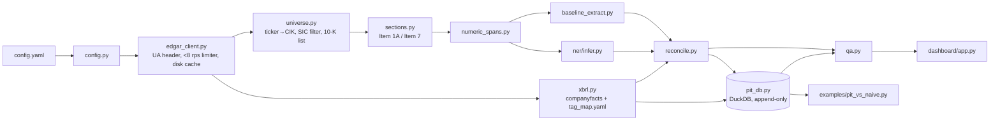

# edgar-extract: plan

This is my reading of the spec, the design that follows from it, and the risks I can see
before writing code. It is a working document; each milestone updates the status table at
the bottom.

## 1. What the spec is really asking for

The product is the **point-in-time (PIT) fundamentals store**. Section isolation, numeric
extraction, the NER model and XBRL reconciliation exist to do two things:

1. put values into that store with full lineage (filing URL, section, sentence, offsets), and
2. measure, honestly, how far numbers read from prose can be trusted next to XBRL.

Downstream projects (Piotroski/Altman screener, DCF, default model) will `import
edgar_extract.pit_db` and call `as_of(date)`. That API has to be small, stable and
impossible to misuse in a way that leaks the future.

## 2. Architecture

Storage layout:

| path | contents |
|---|---|
| `data/raw/<host>/<url path>.gz` | every HTTP response body, gzip-compressed; never fetched twice |
| `data/interim/*.parquet` | universe, sections, extractions, reconciliation |
| `data/interim/skipped.jsonl` | every skipped ticker/filing/section with stage and reason |
| `data/pit.duckdb` | the PIT database |
| `reports/` | section report, NER metrics, mismatch audit |
| `models/` | fine-tuned token classifier and model card |

## 3. Design decisions

**SEC access.** Endpoint formats were checked against SEC's own pages on 2026-10-03
("EDGAR Application Programming Interfaces", "Accessing EDGAR Data", webmaster FAQ):
`data.sec.gov/submissions/CIK##########.json` (with older history in paginated
`filings.files[]`), `data.sec.gov/api/xbrl/companyfacts/CIK##########.json`,
`www.sec.gov/Archives/edgar/data/<cik>/<accession without dashes>/<document>`, and
`www.sec.gov/files/company_tickers.json` for ticker→CIK. SEC's stated ceiling is 10
requests/second with a declared `User-Agent: <name> <email>`. The client refuses to start
without a contact email, and one process-wide limiter spaces requests so that no
one-second window ever holds more than 8 (default 7 req/s). 429 and 5xx get exponential
backoff that honors `Retry-After`. An `offline` mode raises instead of touching the
network; tests and the dashboard use it.

**Cache.** A hand-rolled, content-addressed-by-URL disk cache rather than
`requests-cache`, so the raw filings are plain files under `data/raw/` that other tools
can read. Writes are atomic (temp file + rename). Submissions and companyfacts JSON change
over time; the cache treats them as immutable once fetched, which is right for
reproducibility. A `--refresh` flag forces a refetch of the JSON endpoints only (filing
documents in `Archives/` never change).

**Fiscal year.** Fiscal year is derived from the 10-K's `reportDate` (period end), not
from the filing date: `fiscal_year = year(reportDate)`, minus one when the period ends in
the first 7 days of January (52/53-week years that end on the Saturday nearest Dec 31).
This labels NVDA's year ending 2025-01-26 as FY2025, matching NVDA's own naming. Some
retailers would name the same year differently. That is a documented convention, not a
claim about each company's label.

**Five fiscal years.** For each company, take the five most recent fiscal years that have
an original `10-K` (or `10-KT`). Amendments (`10-K/A`) for those years are kept in the
universe with `is_amendment=True` because they can carry restated numbers, but they never
count toward the five.

**Period identity uses dates, never `fy`/`fp`.** In companyfacts, `fy`/`fp` describe the
*filing*: the FY2024 10-K tags its FY2022 comparatives with `fy=2024`. Keying on them is a
classic look-ahead and duplication bug. Periods are `(period_start, period_end)`. The PIT
key is the spec's `(cik, canonical_field, period_end, filing_date, accession)` **plus
`period_start`**. Without it a fiscal-year revenue figure and the Q4 three-month figure
share a `period_end` and would collide. Instants (balance sheet items) have a null start.

**What is knowable on date D.** A row is knowable on D iff `filing_date <= D`, using
EDGAR's `filingDate`. Filings accepted after 17:30 ET get the next business day as
`filingDate`, so this is already conservative to the day. Backtests that trade at the close
should still lag by one day. `as_of` takes a `lag_days` argument for that, default 0 to
match the spec's invariant exactly.

**Append-only PIT table.** Every report of a value is a row. The FY2022 revenue printed
in the FY2022 10-K and again as a comparative in the FY2023 10-K are two rows with
different `filing_date`/`accession`. If the value changed, that is a restatement (or
recast) and both versions survive. Rows are never updated or deleted. Inserts are
idempotent on the full key, so rerunning the pipeline cannot duplicate or overwrite.
`as_of(D)` returns, per `(cik, field, period_start, period_end)`, the row with the greatest
`filing_date <= D`. Ties go to the later accession, then to `source='xbrl'` over `text`.

**Restatement vs. recast.** Genuine error-correction restatements are rare among large
caps. Most changed prior-period values come from recasts: discontinued operations
(JNJ/Kenvue, GE's spin-offs), segment reorganizations and new accounting standards. The PIT
store records any changed value as a new version, whatever the reason. The `RESTATEMENT`
mismatch cause is defined operationally, as the spec states it ("a later filing for the same
period carries a different value"). The README will say plainly that it does not separate
error corrections from recasts.

**Segment facts are not in companyfacts.** The companyfacts API only aggregates
entity-wide, non-dimensional facts. `SEGMENT_VS_CONSOLIDATED` therefore needs dimensional
facts parsed from the filing's own inline XBRL (`ix:nonFraction` plus its `xbrli:context`
segment members). Every filing in a FY2021+ window is inline XBRL for large filers, so
this is feasible. It is still a second XBRL source, and the code must keep it separate.

**Text extraction lineage.** Every extracted number keeps the filing URL, accession,
section, the sentence text, the sentence's character offset within the section, and the
span offsets within the sentence. Offsets are into the cleaned section text written to
`sections.parquet`, so they can be re-derived exactly.

**Labels and evaluation.**
- *Silver* labels come from XBRL value matches and inline-XBRL tagged spans. Before relying
  on the latter, measure how much Item 7 prose is actually tagged; most iXBRL tagging is in
  the financial statements, not MD&A.
- *Gold* labels come only from the user, through `labeling.py`. I will not write any gold
  labels myself.
- The 30% gold test split is by company. Silver labels for test-split companies are
  excluded from training too, otherwise the split leaks.
- Metrics are reported on the gold test set only, with `n` beside every number and a flag
  when `n < 30`. The regex baseline is scored on the same sentences.
- Evaluating "precision vs. XBRL" in the dashboard is a different, weaker measure (it can
  only judge spans that have an XBRL counterpart). The dashboard will label it that way.

**Model.** No CUDA GPU (Apple Silicon only), so the model is `distilbert-base-cased`,
fine-tuned on CPU/MPS. Cased matters for financial text ("Services" as a segment name).

## 4. Risks

| risk | mitigation |
|---|---|
| Item 7 incorporated by reference to Exhibit 13 (common for banks, e.g. WFC) | detect the "incorporated by reference" pattern in a short Item 7 body; emit `section_missing_by_reference`; never pull text from the exhibit and call it Item 7 |
| TOC hits, split headings, `Item 7A` false ends, nested tables | longest-span-between-consecutive-headings rule; tests on real filing fixtures for each trap |
| Gold set is small (~200 sentences, ~60 in test) | report n per role and say so; per-role F1 on a handful of examples is noise, and the report will flag it |
| Silver labels are circular with reconciliation (both lean on XBRL) | the model is evaluated on gold only; reconciliation metrics are presented as agreement, not accuracy |
| Transformer may not beat regex | report both as measured |
| No genuine restatement in a large-cap universe | universe includes GE and JNJ (spin-off recasts); M6 measures which companies actually have changed values and adds one to config if needed |
| companyfacts is a moving snapshot | cached on first fetch; the cache date is recorded so a rebuild is reproducible |
| SEC blocks or throttles | declared UA, <8 rps, backoff, cache; 403 aborts loudly instead of retrying |
| M8 sample: 20 stocks, 5 years, yfinance prices | deciles are meaningless at n=20; use a top-vs-bottom split and state it is a bias demonstration, not a trading result; yfinance is unofficial and survivorship-biased |
| `GOOGL`/`GOOG` share a CIK | universe de-duplicates by CIK and logs it |
| Filing date vs. knowable time | `filingDate` + optional `lag_days`; documented |

## 5. Milestones and checkpoints

| | milestone | user checkpoint |
|---|---|---|
| M1 | client, universe, CLI skeleton | contact email (done); review universe before first full filing download |
| M2 | section isolation, ≥15 fixture filings, `section_report.csv` | |
| M3 | numeric spans, regex baseline, `extractions.parquet` | |
| M4 | silver labels, labeling tool, DistilBERT, metrics | **user labels ~200 sentences**; I stop and wait |
| M5 | `tag_map.yaml`, reconciliation, mismatch causes, audit | the 25-mismatch audit needs a human judgment; I will draft it with my reasoning per case and mark it as my review, not the user's |
| M6 | PIT DB, invariants, property test | |
| M7 | Streamlit dashboard | |
| M8 | `pit_vs_naive.py`, README polish, `v0.1.0` | |

## 6. Status

- **M1 done** (2026-10-03). The universe stage selects 102 filings (100 original 10-Ks plus
  2 DIS 10-K/A) for 20 companies, with 0 skips once XOM is pinned to its predecessor CIK.
  Found on live data: XOM's ticker moved to a successor holding company (CIK 2115436,
  8-K12B on 2026-07-01). The universe builder now explains this case in the skip log.
  JPM needed 40 paginated history files to reach five 10-Ks (structured-note volume);
  pages are fetched lazily and cached.
- **M2 done** (2026-10-03). 204 sections from 102 filings. Live data showed four layouts
  beyond the textbook one: Exhibit 13 incorporation (WFC), an in-document page reference
  (JPM), a Form 10-K cross-reference index (GE, INTC) and a named-section reference
  (XOM). Each is handled by an explicit rule and covered by a synthetic test plus golden
  checks on 20 recorded filings (one per company). Two AAPL Item 7s are flagged as short
  outliers; that is genuine (Apple's MD&A is about 15k characters against a 68k median).
- **M3 done** (2026-10-03). 18,087 numeric entities from 95 filings, with lineage verified
  exactly for every row. A first sample showed table rows leaking into "prose" and several
  cue false positives ("amended and restated", HELOC "recast", accounting "guidance",
  "settlement of stock-based compensation"); the rules were tightened against general
  patterns, not those sentences. The baseline's accuracy is measured on gold labels in M4.
