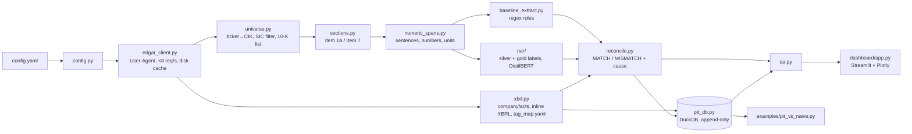

# edgar-extract

`edgar-extract` turns SEC 10-K filings into numbers you can backtest on without
look-ahead. It:

1. downloads 10-Ks from EDGAR for a configurable universe (cached, rate-limited, with a
   declared User-Agent);
2. isolates **Item 7 (MD&A)** and **Item 1A (Risk Factors)**;
3. extracts numeric entities from the prose (revenue, guidance, one-time charges, restated
   prior-period figures), using a regex baseline and a DistilBERT token classifier;
4. reconciles every extracted value against XBRL and classifies **why** each mismatch
   exists;
5. stores everything in a **point-in-time (PIT) database**, so a query "as of date D"
   returns only what was knowable on D, with every restatement kept as its own version;
6. reports extraction quality in an offline QA dashboard.

The PIT database is the core deliverable. Other projects import it:

```python
from edgar_extract.pit_db import PointInTimeDB

pit = PointInTimeDB("data/pit.duckdb", read_only=True)
pit.as_of("2022-03-01", tickers=["AAPL", "GE"], fields=["Revenues", "Assets"])
```

> **Status (2026-10-06).** All milestones are built and tested except the final M4 step:
> the NER model's metrics need ~200 human gold labels, which only a person can provide
> (`edgar-extract label`; see [Labeling](#m4-labeling-and-the-ner-model)). 27 usable gold
> sentences exist so far. No gold labels or NER metrics are fabricated. [PLAN.md](PLAN.md) records the design, risks and what
> each milestone found.

## Architecture



| stage | module | output |
|---|---|---|
| universe | `universe.py` | `data/interim/universe.parquet` |
| sections | `sections.py` | `data/interim/sections.parquet`, `reports/section_report.csv` |
| extract | `numeric_spans.py`, `baseline_extract.py` (or `ner/infer.py`) | `data/interim/extractions.parquet` |
| xbrl | `xbrl.py` | companyfacts, canonical facts, inline-XBRL facts (Parquet) |
| reconcile | `reconcile.py` | `data/interim/reconciliation.parquet` |
| pit | `pit_db.py` | `data/pit.duckdb` |
| qa | `qa.py` | `reports/qa_summary.md` |

Raw responses are cached under `data/raw/` and never fetched twice. Every skipped ticker,
filing or section is logged with a reason to `data/interim/skipped.jsonl`.

## Quick start

Requires Python 3.11+ and [uv](https://docs.astral.sh/uv/).

```bash
uv sync --all-extras                        # core + ner + dashboard + examples
uv run edgar-extract run --config config.yaml   # all stages: about 1 min from cache
```

The first run downloads about 450 MB of filings (31 MB gzipped in the cache) at under 8
requests per second. Later runs work offline with `--offline`.

Edit [`config.yaml`](config.yaml) first:
- `sec.contact_email` is **required**. Every request sends
  `User-Agent: <app_name> <contact_email>`, as SEC's fair-access policy asks. It can also
  be set with `EDGAR_EXTRACT_SEC__CONTACT_EMAIL`.
- `universe.tickers` lists the companies.
- `universe.cik_overrides` pins a ticker to a historical CIK.
- `sic_include` / `sic_exclude` are optional SIC filters (`"3571"`, `"6000-6999"`).
- `years` is the number of fiscal years per company (default 5).

### CLI

```bash
uv run edgar-extract run [--stage universe|sections|extract|xbrl|reconcile|pit|qa|all] [--offline] [--refresh] [--rebuild-pit]
uv run edgar-extract extract --ticker AAPL --years 5 [--extractor regex|ner]
uv run edgar-extract asof --ticker GE --date 2023-03-01 --field Revenues [--include-text] [--lag-days 1]
uv run edgar-extract screen --date 2024-05-01 [--tickers AAPL,GE] [--csv out.csv]
uv run edgar-extract dashboard [--port 8501]
uv run edgar-extract label [--prepare | --status | --audit | --discard-fast] [--labeler INITIALS]
uv run edgar-extract ner train
uv run edgar-extract ner evaluate
```

`asof` prints each period's value as it was knowable on the date, next to today's latest
value. GE as of 2023-03-01 shows FY2022 revenue at $76.6B against $29.1B today (-61.9%).

## M6: point-in-time database

```python
pit.as_of(date, tickers=None, fields=None)  # latest value per (cik, field, period) known on date
pit.history(ticker, field)  # every version, restatements included
pit.latest_vs_asof(ticker, field, date)  # the look-ahead gap per period
pit.restatements(tickers=None, fields=None)  # periods whose value changed after first report
```

- **Keyed by dates, never fiscal labels.** The key is `(cik, canonical_field,
  period_start, period_end, filing_date, accession)` plus `source`, `extractor` and the
  text span. `period_start` extends the spec's key so a fiscal-year figure and the Q4
  figure ending the same day cannot collide. It is NULL for balance-sheet instants.
  companyfacts' `fy`/`fp` describe the *filing*, not the period, and are never used as a
  key.
- **Append-only.** Every report of a value is its own row: the original, each comparative
  re-reported in later 10-Ks, and every restatement. The class exposes no update or delete.
  Rebuilds are idempotent, because rows are identified by a hash of their key columns.
  Text rows keep the reconciliation cause from the run that ingested them. After changing
  reconciliation rules, `run --stage pit --rebuild-pit` recreates the database from the
  current artifacts and swaps it in atomically.
- **Knowable on D** means `filing_date <= D`. EDGAR's filing date already moves
  after-hours acceptances to the next business day; `lag_days=1` adds a day for strategies
  that trade on D.
- **`as_of(D)`** picks, per (company, field, period), the latest `filing_date <= D`; ties go
  to the later accession, then XBRL over text. Defaults suit screeners: annual and instant
  periods, XBRL only. `sources=("xbrl", "text")` adds text-extracted values, except those
  reconciliation classified `EXTRACTION_ERROR`.
- **Columns:** `value_usd`, `unit`, `source` (`xbrl`/`text`), `extractor`, `confidence`
  (1.0 for XBRL; model probability for NER; NULL for regex, which has no calibrated score),
  `mismatch_cause`, `xbrl_tag`, and lineage. Lineage is the filing-index URL for XBRL rows;
  for text rows it is the document URL, section, character span and sentence.
- **Fields:** 29 canonical fields from [`tag_map.yaml`](src/edgar_extract/tag_map.yaml):
  revenue, costs, R&D, SG&A, restructuring, impairment, litigation, operating and net
  and pre-tax income, EPS, shares, cash flow, capex, and balance-sheet totals. Together
  they cover Piotroski, Altman and DCF inputs, apart from prices.

**Built from the default universe:** 90,546 rows (88,577 XBRL facts across every filing
that reported them, plus 1,969 reconciled text values). By `pit.restatements()`, 147 annual
(company, field, period) values ending 2020 or later changed after first being reported
(545 including balance-sheet instants). For example:
- **GE FY2022 revenue:** $76.6B as first reported (filed 2023-02-10), then $58.1B after the
  GE HealthCare spin-off, then $29.1B after GE Vernova.
- **JNJ FY2022 revenue:** $94.9B, then $80.0B after the Kenvue separation.

**Tested invariants**, on synthetic data and on these real JNJ and GE restatements:
- (a) a query before a restatement returns the original value;
- (b) a query after it returns the restated value;
- (c) a query before the original filing returns nothing;
- (d) no result ever has `filing_date > date`.

A Hypothesis property test covers (d) and checks agreement with a brute-force
recomputation for 150 random dates, field sets, tickers and lags.

### Point-in-time screens: Piotroski F-score and Altman Z''

```python
from edgar_extract.screens import screen

screen(pit, "2024-05-01")  # one row per company, using only data filed by that date
```

`edgar-extract screen --date 2024-05-01` computes both scores from `as_of`.
- **No look-ahead:** every row carries `knowable_by`, the latest filing date among its
  inputs, which is never after the screen date.
- **Fiscal years** come from annual periods reported in a 10-K. 10-Q trailing-twelve-month
  and proxy pay-versus-performance figures are also year-long, but they don't define fiscal
  years; on a first pass they mis-anchored AMZN.
- **Labeled fallbacks** fill gaps; each is listed in `derived`:
  - gross profit = revenue - cost of revenue;
  - liabilities = liabilities and equity - equity;
  - EBIT = pre-tax income + interest expense;
  - shares = shares outstanding.
- **Missing inputs are never imputed.** They make a signal `None` and are listed in
  `missing`.

Coverage as of 2024-05-01:
- **Piotroski:** 15 of 20 companies have all 9 signals. Compare scores only within that
  group (`f_complete`).
- **Altman Z″** (the book-equity version for non-manufacturers; the original Z needs
  market cap) is undefined for JPM and WFC (banks have no working capital) and for GE (its
  interest expense uses a custom XBRL concept that companyfacts omits).

## M8: does point-in-time matter? ([full report](reports/pit_vs_naive.md))

`examples/pit_vs_naive.py` runs one ROA signal (top-quintile minus bottom-quintile; deciles
are meaningless with 20 names) from the PIT DB with yfinance prices, two ways each year.
The **PIT** version uses figures as filed by the rebalance date. The **naive** version uses
the latest fiscal year *ended* by then, with today's restated values. **It is a
demonstration of the bias, not a trading claim:** 20 survivorship-biased large caps and 15
annual periods.

| rebalance | ROA inputs that differ | from timing / restatement | years quintiles differ | mean \|yearly L/S gap\| | mean gap (SE) |
|---|---|---|---|---|---|
| May 1 (primary, chosen before running) | 84 of 558 | 6 / 78 | 3 of 15 | 1.3% | +0.3% (0.9%) |
| Feb 15 (sensitivity, inside filing season) | 325 of 558 | 300 / 25 | 13 of 15 | 13.3% | +1.8% (5.8%) |

Neither average gap is distinguishable from zero over 15 periods. What the test does show:
- Restatements alone changed **15% of inputs**.
- Inside filing season, the naive backtest is a **different strategy**: it holds different
  stocks in 13 of 15 years, and its yearly return differs by 13 points on average.

How much look-ahead matters depends on the signal and the calendar; the PIT DB removes the
question.

## M2: section isolation

`sections.py` renders filing HTML into paragraph and table-row blocks. It drops hidden
inline-XBRL content, normalizes `&nbsp;`, unicode dashes and quotes, tracks page breaks,
and strips running headers and footers. Then:

1. **An Item heading** is a short block starting `Item <n>[A-D]` in any punctuation style
   (`Item 7.`, `ITEM 7 -`, `ITEM 1A.RISK FACTORS`, a `<td>Item 7.</td><td>MD&A</td>` row,
   or a heading split across tags). "Item 7 of this report..." is a cross-reference, not a
   heading.
2. **A section runs to the next heading of a later item** (`7A`/`8` for Item 7; `1B`/`1C`/`2`
   for Item 1A), and the **longest span wins**, which discards table-of-contents hits.
3. **Short spans are stubs**, classified by what they say:
   - incorporation by reference to the Annual Report / Exhibit 13 gives
     `section_missing_by_reference`, and no text is guessed (WFC);
   - an in-document page reference (JPM "appears on pages 52-167"; the GE and INTC Form 10-K
     cross-reference index) is resolved through the printed page numbers;
   - a named-section reference (XOM, 'the section entitled "Management's Discussion..."') is
     resolved to the pages whose running header carries that title.

| item | ok: heading | ok: page ref. | ok: named ref. | by reference | not found |
|---|---|---|---|---|---|
| 1A | 85 | 10 | 0 | 5 (WFC) | 2 (DIS 10-K/A, Part III only) |
| 7 | 75 | 15 | 5 (XOM) | 5 (WFC) | 2 (DIS 10-K/A, Part III only) |

The results are pinned by golden checks on 20 recorded filings (one per company) plus a
synthetic test for each trap in the spec. [`reports/section_report.csv`](reports/section_report.csv)
lists character counts per section and flags outliers.

## M3: numeric extraction (regex baseline)

`numeric_spans.py` splits prose paragraphs into sentences and detects numeric entities:
- `$1.2 billion`, `$845 million`, `$(3.1) million`, per-share amounts;
- `12.4%`, `(2)%`, percentage and basis points;
- scaled counts and `(3.1)`;
- ranges (`$1.2 to $1.4 billion`; the scale on one end applies to both).

Each entity gets a kind: level, delta ("increased $142 million"), pct, pct_change
("increased 12% to $Y"), and so on. Values are normalized to base units with the scale kept
explicit. Years, note numbers, dates and table rows are skipped.

`baseline_extract.py` assigns roles with ordered keyword rules: GUIDANCE, RESTATED_PRIOR,
then the nearest keyword among LITIGATION_RESERVE, ONE_TIME_CHARGE, RD_EXPENSE and REVENUE,
else OTHER_NUMERIC. It records the deciding cue for auditing.

**Result: 18,087 entities from 95 filings.** Every row's `text[span_start:span_end] ==
raw_text` against the stored section text, which is the lineage check.

## M4: labeling and the NER model

- **Silver labels** (automatic). A dollar amount whose value equals an XBRL fact of *the
  same filing*, within the text's rounding, gets the role its tag implies.
  - **Why the 0.1% limit:** a first version accepted coarse numbers, and an audit found most
    of those matches were coincidences. A 10-K holds about 1,500 dollar facts, so "$1.2
    billion" (±4%) collides with about 8 of them by chance. Matching is now limited to
    numbers precise to 0.1%, leaving **962 silver spans**.
  - **Inline XBRL was checked first**, as the spec asks: only **0.68%** of Item 7 prose
    dollar amounts and 0% of Item 1A are tagged
    ([reports/ixbrl_coverage.md](reports/ixbrl_coverage.md)).
- **Gold labels** (a person). 218 sentences in
  [`labels/gold_candidates.jsonl`](labels/gold_candidates.jsonl), stratified by keyword and
  company, never by an extractor's output. The tool never shows a suggestion.
  [`labels/LABELING_GUIDE.md`](labels/LABELING_GUIDE.md) defines each role.
- **Model.** `distilbert-base-cased` token classifier (`O` plus five roles) over the shared
  candidate spans, trained on silver plus the gold training split. Sentences long enough
  for several windows are handled. **30% of gold sentences are held out by company**, and
  those companies are excluded from silver training too. Hyperparameters were fixed in
  advance.
- **Evaluation.** Span-level P/R/F1 per role, with n and 95% intervals, for regex and NER
  on the same test spans, written to `reports/ner_metrics.md` plus
  `models/ner/MODEL_CARD.md`. Evaluation refuses to run without at least 50 gold
  sentences.
- **Label audit.** Each gold sentence stores how long it was on screen. Sentences saved
  in under 1.5 s per number are excluded from training and evaluation (the metrics report
  states how many). `label --audit` lists them along with labels the guide excludes, and
  `label --discard-fast` moves them aside so they can be relabeled. The tool also drops
  typed-ahead keys, so a held key or a paste cannot label spans nobody saw.

```bash
uv run edgar-extract label --labeler <initials>   # one keypress per number; resumable
uv run edgar-extract ner train && uv run edgar-extract ner evaluate
```

**No NER metrics yet.** The first labeling pass saved 206 sentences, but 179 were saved
at 0 to 1 s each (`label --audit`), leaving 27 usable, below the 50 minimum.

## M5: XBRL reconciliation and mismatch causes

`xbrl.py` flattens companyfacts into one row per fact per reporting filing, and maps tags
to canonical fields by priority ([`tag_map.yaml`](src/edgar_extract/tag_map.yaml)). It also
parses each filing's inline XBRL for **dimensional** facts (segments, products,
geographies), which companyfacts omits.

`reconcile.py` compares each role-bearing dollar amount with the fact for the same company,
field and fiscal year:
- **Year:** read from the text ("in 2023", "..., respectively", "prior year"), else the
  filing's own year.
- **Fact:** the value as reported in the same filing, never a later one.
- **Change amounts** ("revenue increased $1.0 billion") are compared with fact(t) -
  fact(t-1) from the same filing (`comparison="change"`). "compared to 2023" names the
  base year. Change amounts are never stored in the PIT DB as field values.

Each mismatch gets exactly one cause, by ordered rules:
1. RESTATEMENT;
2. NON_GAAP_ADJUSTMENT;
3. SEGMENT_VS_CONSOLIDATED;
4. SCALE_OR_ROUNDING;
5. EXTRACTION_ERROR.

Rules that search many candidate values fire only when the text is precise enough, or
corroborated, so that coincidences are not counted as causes. Corroboration means the
segment is named in the sentence, or in the headings just above it (for example
"North America:" above a segment discussion), with the number within 5%. Each cause has a
synthetic unit test.

| regex extractor, 3,270 role-bearing extractions | values | changes | total |
|---|---|---|---|
| MATCH | 202 | 102 | 304 |
| MISMATCH | 1,767 | 470 | 2,237 |
| NO_XBRL_COUNTERPART (guidance, quarters, unmapped roles) | 725 | 4 | 729 |

Mismatch causes overall:

| cause | n |
|---|---|
| EXTRACTION_ERROR | 1,667 |
| SEGMENT_VS_CONSOLIDATED | 513 |
| NON_GAAP_ADJUSTMENT | 33 |
| SCALE_OR_ROUNDING | 22 |
| RESTATEMENT | 2 |

Change amounts add 102 exact matches, e.g. CAT's "+$9.223 billion" = FY2021 - FY2020 sales,
and BA's "R&D increased by $603 million".

[`reports/mismatch_audit.md`](reports/mismatch_audit.md) reviews 25 random value
mismatches; it predates change-amount reconciliation. The reviewer was Claude, not yet the
project owner, and n = 25 < 30.
- The rules assigned the right cause in **20 of 25 (80%, 95% CI 61-91%)**.
- Most EXTRACTION_ERRORs are real regex role errors or wrong-year attributions.
- The misses were segment amounts named only in section headings, plus two taxonomy gaps.
  Heading context now catches the two KHC cases; that is 22/25 **on the same sample that
  motivated the change**, so it is not an unbiased estimate.

## M7: QA dashboard

`edgar-extract dashboard` serves a local Streamlit app built only from local artifacts.
It makes no network calls, and Streamlit telemetry is off. It shows:
- precision (agreement) and recall **against XBRL** by company, year and mismatch
  category, with 95% intervals and greyed bars where n < 30;
- the mismatch-cause breakdown;
- per-filing role coverage;
- a PIT coverage heatmap (company by fiscal year, by versioned rows);
- agreement over time per extractor;
- gold-label metrics once they exist.

The same numbers are in [`reports/qa_summary.md`](reports/qa_summary.md). These rates
measure agreement with XBRL, not correctness: a segment figure read correctly still
mismatches consolidated XBRL. Results:
- **Agreement:** 12.0% of comparable extractions match XBRL (2,541 values and changes);
  for R&D it is 48.6%, since MD&A mostly states R&D as a change.
- **Revenue recall:** 58 of 100 10-Ks state their consolidated revenue in prose in a way
  that matches XBRL.
- **Role coverage:** a median 18% of MD&A numbers get a specific role.

## M1: SEC access

- **Endpoints**, verified against sec.gov documentation on 2026-10-03:
  `data.sec.gov/submissions/CIK##########.json` (with paginated history fetched only when
  needed), `data.sec.gov/api/xbrl/companyfacts/CIK##########.json`,
  `www.sec.gov/Archives/edgar/data/<cik>/<accession>/<doc>`, and
  `www.sec.gov/files/company_tickers.json`.
- **Rate limit:** one process-wide limiter spaces requests evenly (default 7/s; config
  rejects anything above 8; SEC's ceiling is 10).
- **Retries:** 429 and 5xx back off and honor `Retry-After`. 403 aborts without retrying.
- **Cache:** gzip files with fetch-time sidecars. `--refresh` refetches only the mutable
  JSON endpoints.
- **Fiscal year** = year of the 10-K's period end, minus one for periods ending in the first
  7 days of January (52/53-week years). This is a convention, not each company's own label.
- **XOM** reorganized under a new holding company on 2026-07-01 (CIK 2115436, 8-K12B). Its
  10-K history stays under CIK 34088, pinned in `config.yaml`. The universe builder explains
  this pattern in the skip log when it meets it.

## Reports

| file | contents |
|---|---|
| [reports/section_report.csv](reports/section_report.csv) | characters per section per filing, outlier flags |
| [reports/ixbrl_coverage.md](reports/ixbrl_coverage.md) | how much section prose is inline-XBRL tagged |
| [reports/mismatch_audit.md](reports/mismatch_audit.md) | 25 random mismatches, reviewed |
| [reports/qa_summary.md](reports/qa_summary.md) | agreement, recall and coverage tables |
| [reports/pit_vs_naive.md](reports/pit_vs_naive.md) | look-ahead demonstration |
| `reports/ner_metrics.md`, `models/ner/MODEL_CARD.md` | written by `ner evaluate` after gold labeling |

## Repository layout

```
src/edgar_extract/
  config.py, edgar_client.py, universe.py, skiplog.py     # M1
  htmltext.py, sections.py                                # M2
  numeric_spans.py, baseline_extract.py                   # M3
  ner/labeling.py, ner/train.py, ner/infer.py, ner/evaluate.py, ner/run.py   # M4
  xbrl.py, tag_map.yaml, reconcile.py                     # M5
  pit_db.py                                               # M6
  qa.py, dashboard/app.py                                 # M7
  pipeline.py, cli.py
examples/pit_vs_naive.py                                  # M8
labels/            gold candidates, labeling guide, gold labels (user-made)
reports/           generated reports (committed)
scripts/           fixture recording, audit sampling
tests/             offline tests; fixtures are trimmed real SEC responses
```

## Development

```bash
uv run pytest                                   # 314 tests, offline: sockets are blocked
uv run ruff check . && uv run ruff format --check .
uv run mypy src                                 # strict
```

Fixtures under `tests/fixtures/` are real SEC responses, trimmed. They include 20 complete
10-K documents and companyfacts for JNJ and GE. `scripts/record_fixtures.py` regenerates
them.

## Known limitations

- **Item 7 / 1A incorporated by reference.** WFC places both in the Exhibit 13 annual
  report. They are flagged `section_missing_by_reference` and contribute no text; the
  exhibit is not parsed as a stand-in.
- **Page-referenced sections are page-granular** (JPM, GE, INTC, XOM). They are trimmed at
  item titles, but up to one page of neighboring content can remain, e.g. GE Item 7 ends
  with the Item 5 repurchase table.
- **Small gold set.** The target is ~200 sentences, about 60 of them in the
  company-held-out test split. Per-role metrics on fewer than 30 spans are flagged as
  unreliable. Silver labels have no GUIDANCE or RESTATED_PRIOR examples and lean toward
  amounts that appear in the financial statements.
- **Small universe.** 20 large-cap US companies and 5 fiscal years for text, chosen in 2026
  (survivorship bias). Results do not transfer to small caps or other periods without
  re-validation.
- **Prose only.** Table rows are skipped. Some companies (e.g. AAPL) state revenue almost
  entirely in tables, so their prose yields few role-bearing numbers.
- **Regex roles are keyword-based.** The audit's main error source is role mistakes (e.g.
  "hedging gains related to revenue" read as REVENUE).
- **Reconciliation compares annual consolidated or dimensional facts.** Quarterly figures
  and change amounts have no counterpart. Concepts missing from `tag_map.yaml` (e.g.
  `OtherCostAndExpenseOperating`) and text that sums several facts fall into
  EXTRACTION_ERROR. The segment rule needs the segment named in the sentence or the
  headings above it (or a precise number), so a coarse segment amount with no nearby
  name is still counted as EXTRACTION_ERROR.
- **RESTATEMENT does not separate error corrections from recasts.** Discontinued
  operations, spin-offs and reclassifications count as restatements, which is how they
  should be treated for look-ahead purposes.
- **Non-USD amounts** are detected but not converted (no FX rates).
- **PIT DB keyed by CIK.** After a holding-company reorganization (XOM 2026), later filings
  arrive under the successor CIK. companyfacts is a snapshot that SEC updates in place; rows
  already ingested are never removed.
- **Fiscal-year labels** follow the period-end convention, not each company's own naming.
