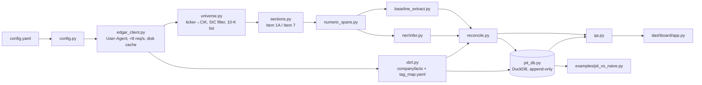

# edgar-extract

A pipeline that downloads 10-K filings from SEC EDGAR, isolates MD&A (Item 7) and Risk
Factors (Item 1A), extracts numeric entities from the prose, reconciles them against XBRL,
and stores the result in a **point-in-time (PIT) fundamentals database**: a query "as of
date D" returns only what was knowable on D.

> Status: **M1-M3 and M5 complete; M4 code complete, waiting for gold labels**
> (SEC client, universe, section isolation, regex baseline, XBRL reconciliation). The
> NER model is trained and scored only after a person labels the gold set (see
> "Labeling"). Later stages
> print "not implemented yet" instead of producing output. See [PLAN.md](PLAN.md) for the
> design, risks and milestone status.

## Architecture



## Install

Requires Python 3.11+ and [uv](https://docs.astral.sh/uv/).

```bash
uv sync
```

## Configure

Edit `config.yaml`:

- `sec.contact_email`: required. SEC's fair-access policy asks automated clients to declare
  themselves; every request sends `User-Agent: <app_name> <contact_email>`. It can also be set
  with `EDGAR_EXTRACT_SEC__CONTACT_EMAIL`.
- `universe.tickers`: the companies to process. `universe.cik_overrides` pins a ticker to a
  CIK when SEC's ticker file is wrong for historical work (see XOM below).
- `universe.sic_include` / `sic_exclude`: optional SIC filter, as codes (`"3571"`) or
  ranges (`"6000-6999"`).
- `years`: number of most recent fiscal years of 10-K filings per company (default 5).

## Usage

```bash
uv run edgar-extract run --config config.yaml --stage universe
```

This resolves tickers to CIKs, applies the SIC filter, selects the most recent five fiscal
years of original 10-K filings (plus any 10-K/A for those years, flagged as amendments),
prints the table, and writes `data/interim/universe.parquet`. Add `--offline` to run
purely from cache, or `--refresh` to refetch the mutable JSON endpoints.

```bash
uv run edgar-extract run --config config.yaml --stage sections
```

This downloads each filing's primary document (cached), isolates Item 1A and Item 7, writes
`data/interim/sections.parquet` (clean text with paragraph offsets and lineage columns) and
`reports/section_report.csv` (character counts per section per filing, outliers flagged).
`--stage all` runs every implemented stage in order.

```bash
uv run edgar-extract run --stage extract              # whole universe -> extractions.parquet
uv run edgar-extract extract --ticker AAPL --years 5  # one company -> extractions_AAPL_regex.parquet
```

```bash
uv run edgar-extract run --stage xbrl        # companyfacts + inline-XBRL facts per filing
uv run edgar-extract run --stage reconcile   # -> reconciliation.parquet
```

Stage commands that land in later milestones (`asof`, `dashboard`, and
`run --stage pit|qa`) currently exit non-zero with a message saying which milestone
implements them.

## SEC access

- Endpoints (checked against sec.gov documentation on 2026-10-03):
  `data.sec.gov/submissions/CIK##########.json` (plus paginated older history),
  `data.sec.gov/api/xbrl/companyfacts/CIK##########.json`,
  `www.sec.gov/Archives/edgar/data/<cik>/<accession>/<doc>`, and
  `www.sec.gov/files/company_tickers.json`.
- **Rate limit:** one process-wide limiter spaces requests evenly (default 7/s; the config
  rejects anything above 8). SEC's ceiling is 10/s.
- **Cache:** every response body is stored gzip-compressed under `data/raw/<host>/<path>.gz`,
  with a `.meta.json` that records when it was fetched. Reruns never re-download.
- **Errors:** 429 and 5xx get exponential backoff that honors `Retry-After`. 403 aborts
  without retrying, because it usually means a missing User-Agent or a block. 404 is logged
  as a skip.

## Section isolation (Item 1A, Item 7)

`sections.py` turns the filing HTML into paragraph and table-row blocks, with hidden
inline-XBRL content removed, typography normalized (`&nbsp;`, unicode dashes and quotes) and
page breaks tracked. It strips running headers and footers, then applies these rules:

1. An **Item heading** is a short block starting with `Item <n>[A-D]` in any punctuation
   style (`Item 7.`, `ITEM 7 -`, `ITEM 1A.RISK FACTORS`, a `<td>Item 7.</td><td>MD&A</td>`
   row, a heading split across `<b>` tags). `Item 7 of this report...` is a cross-reference,
   not a heading.
2. A section runs from its heading to the next heading of a **later** item (`7A` or `8`
   for Item 7; `1B`, `1C` or `2` for Item 1A). Among all candidate headings, **the longest
   span wins**, which discards table-of-contents hits.
3. **Short spans are stubs** and are classified by what they say:
   - incorporation by reference to the Annual Report / Exhibit 13 gives
     `section_missing_by_reference`, and no text is guessed (WFC, all years);
   - a page reference into the same document (JPM: "appears on pages 52-167", or a
     Form 10-K cross-reference index row as at GE and INTC) is resolved through the printed
     page numbers in the running footers (`method=page_reference`);
   - a named-section reference (XOM: 'the section entitled "Management's Discussion..." in
     the Financial Section of this report') is resolved to the pages whose running header
     carries that title (`method=named_section_reference`).

Results on the 102 filings in the default universe (FY2021-FY2025):

| item | ok (heading) | ok (page ref.) | ok (named ref.) | by reference | not found |
|---|---|---|---|---|---|
| 1A | 85 | 10 | 0 | 5 (WFC) | 2 (DIS 10-K/A, Part III only) |
| 7 | 75 | 15 | 5 (XOM) | 5 (WFC) | 2 (DIS 10-K/A, Part III only) |

Every non-ok section is also in the skip log with its reason.

## Numeric extraction (regex baseline)

`numeric_spans.py` splits each prose paragraph into sentences (pysbd, offsets located
left to right) and finds numeric entities: dollar amounts with scale words (`$1.2 billion`,
`$845 million`, `$(3.1) million`), per-share amounts, percentages (`12.4%`, `(2)%`),
percentage and basis points, scaled counts, parenthesized decimals, and ranges
(`$1.2 to $1.4 billion`, where the scale on either end applies to both). Each entity gets a
kind: `level`, `delta` ("increased $142 million"), `pct`, `pct_change` ("increased 12%"),
`per_share`, `count`, `points` or `number`. Values are normalized to base units with the
scale kept explicit (`value_usd=1.2e9, unit_scale=1e9`). Years, note and item numbers,
dates, and accounting-standard codes are not extracted.

Table rows are not prose and are skipped. A block counts as prose when it has 5 or more
alphabetic words, letters make up at least half of it, and it is not a line of figures
without sentence punctuation.

`baseline_extract.py` assigns a role by keyword rules, documented in the module, and
records the deciding cue in `role_cue` for auditing. The order is:
1. `GUIDANCE` for a company forward-looking sentence ("we expect", "is expected to",
   "our ... outlook");
2. `RESTATED_PRIOR` for restatement language ("as restated", "have been recast"), but not
   "amended and restated";
3. otherwise the nearest keyword to the left: `LITIGATION_RESERVE`, `ONE_TIME_CHARGE`,
   `RD_EXPENSE` or `REVENUE`;
4. else `OTHER_NUMERIC`.

`extractions.parquet` has one row per numeric entity. Columns:
- the spec columns: `ticker, accession, section, sentence, span_start, span_end, raw_text,
  value_usd, unit_scale, role, extractor`;
- lineage: `primary_doc_url`, `sentence_start/sentence_end`, `filing_date`;
- `value`, `unit`, `numeric_kind`, `is_negative` and range fields.

All offsets index into the section text in `sections.parquet`, and a test checks that
`text[span_start:span_end] == raw_text` for every row.

Baseline on the default universe: **18,087 entities from 95 filings**. That count is only
how often each rule fired, not accuracy; accuracy is measured against gold labels in M4.

| role | Item 1A | Item 7 |
|---|---|---|
| REVENUE | 10 | 1,678 |
| GUIDANCE | 26 | 516 |
| ONE_TIME_CHARGE | 35 | 808 |
| LITIGATION_RESERVE | 1 | 81 |
| RD_EXPENSE | 12 | 100 |
| RESTATED_PRIOR | 0 | 3 |
| OTHER_NUMERIC | 477 | 14,340 |

## Labeling and the NER model (M4)

The silver and gold labels are built and used as follows:

- **Silver labels** (automatic, `edgar-extract label --prepare`): a dollar amount whose value
  equals an XBRL fact *of the same filing* within the text's rounding gets the role the
  fact's tag implies (`tag_map.yaml`). An audit of the first version found that loose
  matches were mostly coincidences: a 10-K holds about 1,500 dollar facts, so "$1.2
  billion" (±4%) collides with about 8 of them by chance. Matching is therefore limited to
  numbers precise to 0.1%. The result is 962 silver spans (828 OTHER_NUMERIC, 107
  REVENUE, 27 ONE_TIME_CHARGE). Inline-XBRL tags were checked first, as the spec asks:
  only **0.68% of Item 7 prose dollar amounts are tagged, and 0% in Item 1A**
  ([reports/ixbrl_coverage.md](reports/ixbrl_coverage.md)), so they add just 103 silver spans.
- **Gold labels** (a person, `edgar-extract label`): a stratified sample of 218 sentences in
  `labels/gold_candidates.jsonl`, drawn by keyword strata and company and never by an
  extractor's output, labeled one keypress per number following
  [labels/LABELING_GUIDE.md](labels/LABELING_GUIDE.md).
- **Model**: DistilBERT-cased token classifier (`O` plus five roles) over the shared
  candidate spans, trained on silver plus the gold training split. 30% of gold sentences
  are held out **by company**, and those companies are excluded from silver training too.
  `edgar-extract ner train`, then `edgar-extract ner evaluate` writes
  `reports/ner_metrics.md` (per-role P/R/F1 with 95% intervals and n, regex and NER on
  the same test spans) and `models/ner/MODEL_CARD.md`. Evaluation refuses to run on fewer
  than 50 gold sentences and never uses silver labels.

```bash
uv sync --extra ner
uv run edgar-extract label --labeler <initials>   # resumable; q saves and quits
uv run edgar-extract ner train
uv run edgar-extract ner evaluate
uv run edgar-extract extract --ticker AAPL --extractor ner
```

**Status: no gold labels exist yet, so there are no NER metrics.** They will appear in
`reports/ner_metrics.md` after labeling.

## XBRL reconciliation (M5)

`xbrl.py` flattens companyfacts into one row per fact *per reporting filing*, so a value
re-reported in later 10-Ks appears once per filing. It maps tags to canonical fields with
the priority table in [`tag_map.yaml`](src/edgar_extract/tag_map.yaml) and parses each
filing's inline XBRL for **dimensional** facts (segments, products, geographies), which
companyfacts omits.

`reconcile.py` compares every dollar amount that has a specific role with the XBRL fact
for the same company, field and fiscal year. The year comes from the text near the number;
"..., respectively" lists and "prior year" wording are handled; otherwise it is the
filing's own year. The fact is the value as reported in that same filing, never a later
one. Each mismatch gets exactly one cause, by ordered and documented rules:
1. `RESTATEMENT`;
2. `NON_GAAP_ADJUSTMENT`;
3. `SEGMENT_VS_CONSOLIDATED`;
4. `SCALE_OR_ROUNDING`;
5. `EXTRACTION_ERROR`.

Rules that search many candidate values must be protected against chance matches. They
fire only when the text's precision makes a coincidence unlikely, or when the sentence
corroborates the match (for a segment, the member's name appears in the sentence). Each
cause has a synthetic unit test.

Results with the regex extractor, over 3,270 role-bearing extractions:

| status / cause | n |
|---|---|
| MATCH | 202 |
| MISMATCH: EXTRACTION_ERROR | 1,458 |
| MISMATCH: SEGMENT_VS_CONSOLIDATED | 254 |
| MISMATCH: NON_GAAP_ADJUSTMENT | 33 |
| MISMATCH: SCALE_OR_ROUNDING | 21 |
| MISMATCH: RESTATEMENT | 1 |
| NO_XBRL_COUNTERPART (guidance, change amounts, quarters, unmapped) | 1,301 |

Only 10.3% of comparable extractions match exactly. The reasons are spelled out
in [reports/mismatch_audit.md](reports/mismatch_audit.md). A review of 25 random mismatches
(by Claude, not yet by the project owner; n = 25 < 30) found:
- the rules assigned the right cause in 20 of 25 (80%, 95% CI 61-91%);
- most EXTRACTION_ERRORs are real regex role errors or wrong-year attributions;
- the misses are segment amounts named only in section headings, and two taxonomy gaps.

## Conventions worth knowing

- **Fiscal year** = year of the 10-K's period end, minus one when the period ends in the
  first 7 days of January (52/53-week years). Some companies name their years differently.
- **Every skip is logged** to `data/interim/skipped.jsonl` with stage and reason. Nothing is
  dropped silently.
- **XOM:** on 2026-07-01 Exxon Mobil reorganized under a new holding company (CIK 2115436),
  and SEC's ticker file now maps XOM there. Its 10-K history is under the predecessor CIK
  34088, so `config.yaml` pins it with `cik_overrides`. When the universe builder meets this
  pattern (a registrant with no 10-Ks whose history starts with an 8-K12B), the skip-log
  entry says so.

## Development

```bash
uv run pytest           # offline: sockets are blocked in tests
uv run ruff check . && uv run ruff format --check .
uv run mypy src
```

Test fixtures under `tests/fixtures/sec/` are trimmed real SEC responses, recorded by
`scripts/record_fixtures.py`.

## Known limitations

Collected here as milestones land.

- **Item 7 / 1A incorporated by reference (WFC):** these sections are flagged
  `section_missing_by_reference` and contribute no text. The Exhibit 13 annual report is
  not parsed as a substitute.
- **Page-referenced sections are page-granular.** For JPM, GE, INTC and XOM the section is
  the set of referenced pages, trimmed to the item's own title on the first page and at the
  next item title on the last page. If the last page's other content has no recognizable
  item title, up to one page of it remains: INTC Item 1A ends with "Other Key Information"
  text, and GE Item 7 ends with the Item 5 share-repurchase table.
- Section text includes table rows (marked in `block_kinds`) so offsets stay exact. The
  extractor reads prose only. Some companies (e.g. AAPL) state revenue almost entirely in
  MD&A tables, so their prose yields few REVENUE entities. That is a property of the
  filings, not a parsing failure, and it limits text-vs-XBRL coverage for those companies.
- Non-dollar amounts (EUR, GBP, JPY, CHF) are detected and labeled `other_currency` but
  never converted, since the pipeline has no FX rates.
- **Gold set is small** (target ~200 sentences, ~60 in the company-held-out test split).
  Per-role metrics on fewer than 30 test spans are flagged as unreliable.
- **Silver labels lack GUIDANCE and RESTATED_PRIOR**, since no XBRL tag implies them, and
  are biased toward amounts that also appear in the financial statements.
- **Reconciliation compares annual, consolidated or dimensional facts only.** Quarterly
  figures, change amounts and components with no XBRL concept get
  NO_XBRL_COUNTERPART or fall into EXTRACTION_ERROR. Concepts outside `tag_map.yaml`
  (e.g. `OtherCostAndExpenseOperating`) and text that sums several facts are taxonomy
  gaps, not extraction errors (see the audit).
- **The segment rule trades recall for precision.** A coarse number must be
  corroborated by the segment's name in the sentence, so amounts named only in a section
  heading are missed.

- Fiscal-year labels follow the period-end convention above, not each company's own naming.
- The PIT database is keyed by CIK. After a holding-company reorganization (XOM, 2026),
  filings after the reorganization arrive under the successor CIK.
