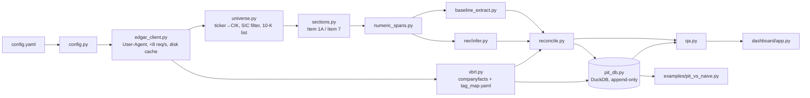

# edgar-extract

A pipeline that downloads 10-K filings from SEC EDGAR, isolates MD&A (Item 7) and Risk
Factors (Item 1A), extracts numeric entities from the prose, reconciles them against XBRL,
and stores the result in a **point-in-time (PIT) fundamentals database**: a query "as of
date D" returns only what was knowable on D.

> Status: **M1 complete** (SEC client, universe builder, CLI skeleton). Later stages print
> "not implemented yet" instead of producing output. See [PLAN.md](PLAN.md) for the design,
> risks and milestone status.

## Architecture



## Install

Requires Python 3.11+ and [uv](https://docs.astral.sh/uv/).

```bash
uv sync
```

## Configure

Edit `config.yaml`:

- `sec.contact_email`: required. SEC's fair-access policy asks automated clients to declare
  themselves; every request sends `User-Agent: <app_name> <contact_email>`. It can also be set
  with `EDGAR_EXTRACT_SEC__CONTACT_EMAIL`.
- `universe.tickers`: the companies to process. `universe.cik_overrides` pins a ticker to a
  CIK when SEC's ticker file is wrong for historical work (see XOM below).
- `universe.sic_include` / `sic_exclude`: optional SIC filter, as codes (`"3571"`) or
  ranges (`"6000-6999"`).
- `years`: number of most recent fiscal years of 10-K filings per company (default 5).

## Usage

```bash
uv run edgar-extract run --config config.yaml --stage universe
```

This resolves tickers to CIKs, applies the SIC filter, selects the most recent five fiscal
years of original 10-K filings (plus any 10-K/A for those years, flagged as amendments),
prints the table, and writes `data/interim/universe.parquet`. Add `--offline` to run
purely from cache, or `--refresh` to refetch the mutable JSON endpoints.

Stage commands that land in later milestones (`extract`, `asof`, `dashboard`, and
`run --stage sections|extract|xbrl|reconcile|pit|qa`) currently exit with code 2 and a
message saying which milestone implements them.

## SEC access

- Endpoints (checked against sec.gov documentation on 2026-10-03):
  `data.sec.gov/submissions/CIK##########.json` (plus paginated older history),
  `data.sec.gov/api/xbrl/companyfacts/CIK##########.json`,
  `www.sec.gov/Archives/edgar/data/<cik>/<accession>/<doc>`, and
  `www.sec.gov/files/company_tickers.json`.
- **Rate limit:** one process-wide limiter spaces requests evenly (default 7/s; the config
  rejects anything above 8). SEC's ceiling is 10/s.
- **Cache:** every response body is stored gzip-compressed under `data/raw/<host>/<path>.gz`,
  with a `.meta.json` that records when it was fetched. Reruns never re-download.
- **Errors:** 429 and 5xx get exponential backoff that honors `Retry-After`. 403 aborts
  without retrying, because it usually means a missing User-Agent or a block. 404 is logged
  as a skip.

## Conventions worth knowing

- **Fiscal year** = year of the 10-K's period end, minus one when the period ends in the
  first 7 days of January (52/53-week years). Some companies name their years differently.
- **Every skip is logged** to `data/interim/skipped.jsonl` with stage and reason. Nothing is
  dropped silently.
- **XOM:** on 2026-07-01 Exxon Mobil reorganized under a new holding company (CIK 2115436),
  and SEC's ticker file now maps XOM there. Its 10-K history is under the predecessor CIK
  34088, so `config.yaml` pins it with `cik_overrides`. When the universe builder meets this
  pattern (a registrant with no 10-Ks whose history starts with an 8-K12B), the skip-log
  entry says so.

## Development

```bash
uv run pytest           # offline: sockets are blocked in tests
uv run ruff check . && uv run ruff format --check .
uv run mypy src
```

Test fixtures under `tests/fixtures/sec/` are trimmed real SEC responses, recorded by
`scripts/record_fixtures.py`.

## Known limitations

Collected here as milestones land.

- Fiscal-year labels follow the period-end convention above, not each company's own naming.
- The PIT database is keyed by CIK. After a holding-company reorganization (XOM, 2026),
  filings after the reorganization arrive under the successor CIK.
